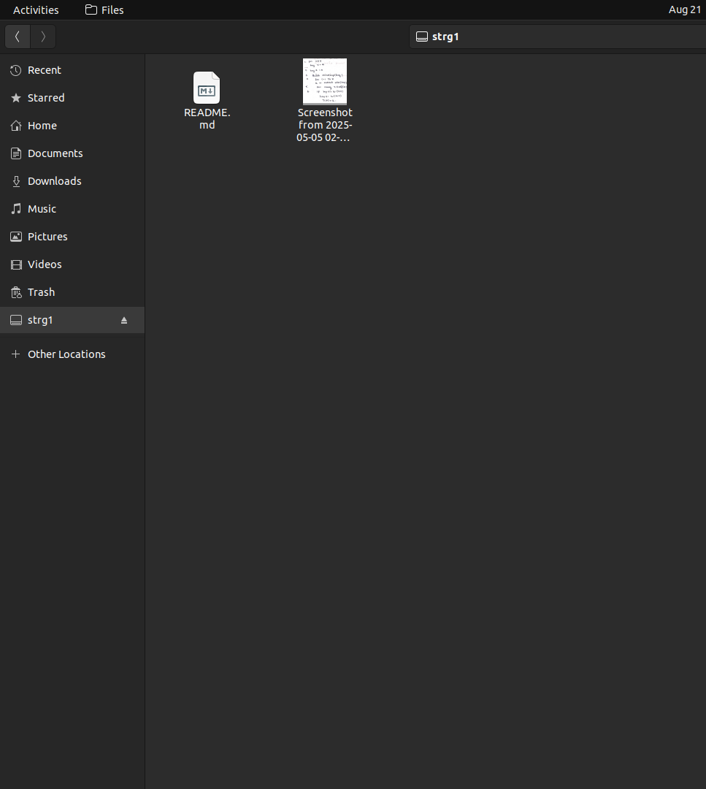
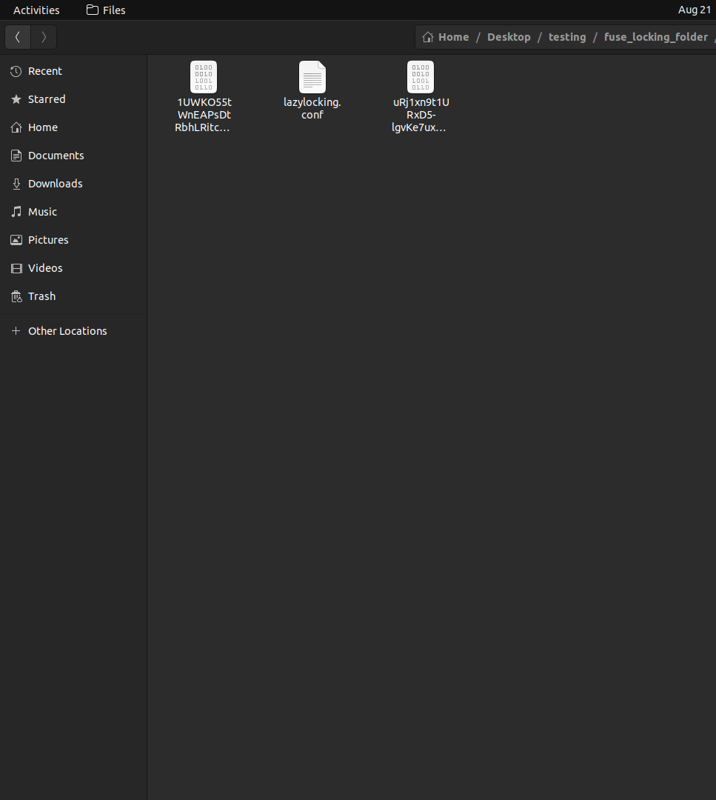

     # FileLocker 🔐
A high-performance file encryption and secure vault system built in C++ with modular encryption support (currently AES-256-GCM) and FUSE filesystem integration.

## Table of Contents 📋

<div align="center">

[Demo](#demo-) • 
[Dependencies](#dependencies-) • 
[Usage](#usage-) • 
[Troubleshooting](#troubleshooting-) • 

</div>

## Overview 📖

FileLocker is a comprehensive file security solution that provides:
- **fort++**: A command-line file encryption tool with master key management 🛠️
- **openfort**: A FUSE-based encrypted filesystem for transparent file access 🗂️

## Screenshots 📸


### Before & After Encryption

<div align="center">

| Original Files | Encrypted Files |
|:-------------:|:--------------:|
|  |  |
| *Clear filenames and readable content* | *Encrypted filenames and secure storage* |

</div>

## Demo 🎥

### Watch FileLocker in Action

<div align="center">

[](https://www.youtube.com/watch?v=Tf2Y46hyKlM&ab_channel=AshishRanjan)

**🎬 [Watch Full Demo on YouTube](https://www.youtube.com/watch?v=Tf2Y46hyKlM&ab_channel=AshishRanjan)**

*See how FileLocker encrypts your files and provides transparent access through FUSE mounting*

</div>

### What You'll See in the Demo:
- 🚀 Quick setup and initialization
- 🔒 Real-time file encryption process
- 📁 Transparent filesystem mounting
- 🔐 Secure file access and operations
- ⚡ Performance benchmarks

## Features ✨

- **Encryption**: AES-256-GCM with authenticated encryption 🔐
- **Master key management**: Secure key derivation and storage 🔑
- **Transparent filesystem**: Mount encrypted directories as normal folders 📁
- **Filename encryption**: Both file contents and names are encrypted 🔤
- **URL-safe encoding**: Base64 URL-safe encoding for encrypted filenames 🌐
- **Cross-platform**: Built with standard C++ and OpenSSL 🖥️

## Architecture 🏗️

```
FileLocker/
├── fort++/          # File encryption tool
│   ├── config/      # Configuration management
│   ├── crypto/      # Cryptographic utilities
│   └── main.cpp     # Main encryption application
├── openvault/       # FUSE filesystem
│   ├── crypto/      # Crypto operations for FUSE
│   ├── filesystem/  # FUSE operations
│   └── main.cpp     # FUSE mount application
├── screenshots/     # Demo screenshots
└── Makefile         # Build system
```

## Dependencies 📦

- **OpenSSL**: For cryptographic operations (libssl-dev)
- **FUSE**: For filesystem operations (libfuse-dev)
- **C++17**: Modern C++ standard library
- **Linux**: FUSE support (adaptable to other Unix-like systems)

### Installation on Ubuntu/Debian:
```bash
sudo apt-get update
sudo apt-get install build-essential libssl-dev libfuse-dev
sudo apt install nlohmann-json3-dev
sudo apt install libfuse3-dev
```

## Building 🔨

```bash
# Clone the repository
git clone https://github.com/lazylettucewaseaten/fuse_lockingfolder
cd FileLocker

# Build the project
make

# Set executable paths (optional) if this is enabled the command can be used from anywhere instead of figuring out the executable everytime
./setting_path_exec.sh
```

## Usage 🚀

### fort++: File Encryption Tool

#### Initial Setup
```bash
# Initialize configuration (first run)
./fort++ init /path/to/config/folder

# This creates:
# - lazylocking.conf (master key configuration)
# - .diriv  
```

Paths can be relative or absolute for both `fort++` and `openfort`.

`init` refuses to run on a folder that already contains `lazylocking.conf`, since re-initialising would replace the master key and make every existing encrypted file unreadable.

#### Encrypt Files
```bash
# Encrypt all files in a target folder (Mounting)
# Initialise with first empty target folder and then store files.
./openfort /path/to/config/folder /path/to/target/folder

# Files will be:
# - Encrypted with AES-256-GCM
# - Moved to the config folder with encrypted names
# - Original files deleted for security
```

#### Example Workflow
```bash
# 1. Initialize vault
./fort++ init ~/my_vault

# 2. Encrypt documents initial setup
./openfort ~/my_vault ~/Documents/sensitive

# 3. All files are now encrypted in ~/my_vault/
```

### openfort: FUSE Filesystem

```bash
# Mount encrypted vault as normal filesystem
./openfort /path/to/config/folder /path/to/mount/point

# Unmount
fusermount -u /path/to/mount/point
```

## Configuration Files ⚙️

### lazylocking.conf
Contains the Base64-encoded master key:
```
MasterKey:SGVsbG9Xb3JsZCEhISE...
```

## Security Features 🛡️

- **AES-256-GCM**: Provides both confidentiality and authenticity ✅
- **Master Key**: Single key for all file operations 🗝️
- **IV Management**: Consistent IV usage across operations 🔢
- **Filename Encryption**: Directory listings reveal no information 📂
- **Memory Safety**: Secure handling of cryptographic materials 🧠
- **URL-Safe Encoding**: Encrypted filenames are filesystem-compatible 🌐

## File Encryption Process 🔄

1. **File Content**: Encrypted with AES-256-GCM using master key, IV, and salt
2. **Filename**: Also encrypted with same parameters for privacy
3. **Encoding**: Encrypted filename encoded with URL-safe Base64
4. **Storage**: Encrypted file stored with encrypted filename
5. **Cleanup**: Original file securely deleted

## Development 👨‍💻

### Code Structure

#### fort++
- `config/`: Configuration file parsing and management
- `crypto/`: Core cryptographic operations and utilities
- `main.cpp`: CLI interface and file processing logic

#### openvault
- `crypto/`: Crypto operations optimized for FUSE
- `filesystem/`: FUSE operation handlers
- `main.cpp`: FUSE mount and daemon logic

## Security Considerations ⚠️

- **Memory**: Sensitive data should be cleared from memory after use
- **Permissions**: Ensure configuration folder has restricted permissions (700)
- **Backup**: Losing configuration files means losing access to encrypted data
- **IV Reuse**: Current implementation reuses IV - consider implementing per-file IVs for enhanced security

## Troubleshooting 🔧

### Build Issues
```bash
# Missing OpenSSL
sudo apt-get install libssl-dev

# Missing FUSE
sudo apt-get install libfuse-dev

# Permission issues
sudo usermod -a -G fuse $USER

# Stale build after editing headers
make clean
make
```
### Runtime Issues
```bash
# FUSE mount fails
sudo modprobe fuse

# Permission denied on mount
# Add user to fuse group and re-login

# "Vault already initialised" from fort++ init
# The folder already holds a vault; mount it with openfort instead,
# or pick a new empty folder for a new vault
```

## Contributing 🤝

1. Fork the repository
2. Create a feature branch (`git checkout -b feature/amazing-feature`)
3. Commit your changes (`git commit -m 'Add amazing feature'`)
4. Push to the branch (`git push origin feature/amazing-feature`)
5. Open a Pull Request

## Disclaimer ⚠️

This is cryptographic software. While it implements industry-standard encryption (AES-256-GCM), it has not undergone formal security auditing. Use at your own risk for non-critical applications. For production use, consider professional security review.

## Roadmap 🗺️

- [ ] Per-file IV implementation
- [ ] Password-based key derivation (PBKDF2/Argon2)
- [ ] Secure key storage integration
- [ ] Automated testing suite
- [ ] Security audit

---

**FileLocker** - Keeping your files secure! ✨

---

<div align="center">

**Made with ❤️ by lazylettucewaseaten**

</div>
